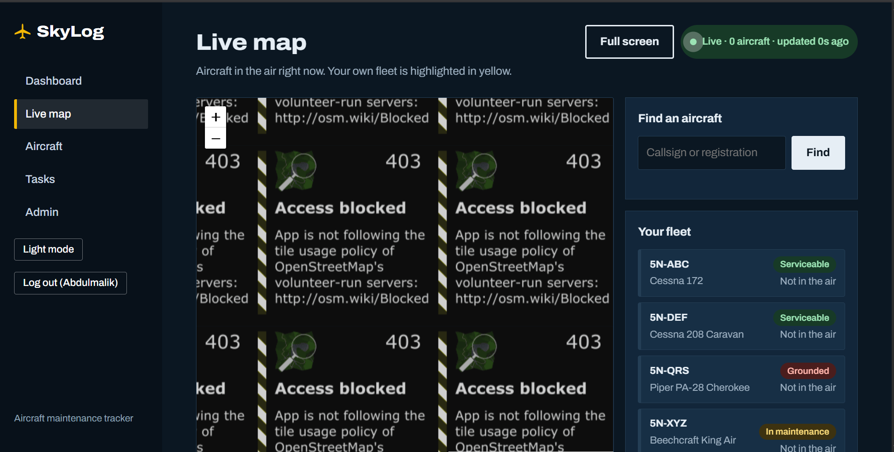
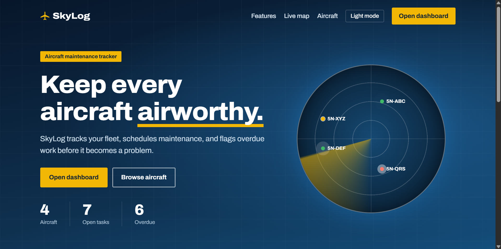

# SkyLog: Aircraft Maintenance Tracker
**Live demo: https://abdulmalik101.pythonanywhere.com**



A web app for tracking an aircraft fleet and its maintenance work, built with
Python and Django. It has a public landing page, a live dashboard, and a
login-protected editor for adding and updating records.

## Features
- Live aircraft map with real-time ADS-B traffic and your own fleet highlighted
- One shared, cached data feed for all visitors, so many people can use it at once without hitting the provider's rate limit
- Falls back to clearly labelled simulated traffic if the live feed is unavailable
- Hide-able sidebar and full screen map
- Landing page with an animated radar showing the fleet
- Dashboard with stat cards, a fleet status donut chart, priority bars and a "Next due" list
- Overdue maintenance highlighted in red automatically
- Aircraft list and detail pages with open-task counts
- Task search and filters (by keyword, status and priority)
- Add, edit and delete tasks and aircraft from the site
- Login required for any change. Visitors can browse but not edit
- Light and dark mode, and a layout that works on phones
- 22 automated tests


## Tech stack

Python, Django, SQLite, HTML, CSS and JavaScript (no front-end frameworks).

## Getting started

Requires Python 3.12 or newer.

```
git clone https://github.com/Umar-Abdulmalik/SkyLog.git
cd SkyLog
python -m venv venv
venv\Scripts\activate        # Mac/Linux: source venv/bin/activate
pip install -r requirements.txt
python manage.py migrate
python manage.py createsuperuser
python manage.py runserver
```

Open http://127.0.0.1:8000/ and log in with the account you just created to
add aircraft and tasks.

## Live aircraft data

The map reads ADS-B positions from [adsb.fi](https://adsb.fi) open data (personal,
non-commercial use). The server fetches each map area once every few seconds and
shares it between all visitors. Settings are read from environment variables, so
no keys or secrets are stored in the code:

| Variable | Purpose |
|---|---|
| `SKYLOG_AIRCRAFT_API_BASE` | Provider address |
| `SKYLOG_AIRCRAFT_POINT_PATH` | Provider's area-search path |
| `SKYLOG_AIRCRAFT_FLEET_LOOKUP` | `list` or `none` |

Run `python manage.py check_feed` to test the feed from any machine.

## Running the tests

```
python manage.py test
```

## Project structure

```
SkyLog/
├── manage.py
├── config/                  # project settings and root URLs
├── tracker/
│   ├── models.py            # Aircraft and MaintenanceTask
│   ├── views.py             # pages, forms and login
│   ├── forms.py
│   ├── urls.py
│   ├── admin.py
│   ├── tests.py
│   ├── templates/tracker/
│   └── static/tracker/      # CSS, JavaScript and font
└── requirements.txt
```

## What I learned

- Structuring a Django project with models, views, templates and URLs
- Class-based views for create, update and delete, with login protection
- Database queries for statistics (counts, filters and annotations)
- Building a responsive, accessible interface with CSS and a little JavaScript
- Writing tests for models, views and permissions

## Ideas for the future

- Maintenance history and file attachments
- Email reminders for tasks that are almost due
- A REST API so other apps can read the data

## Author

Umar Abdulmalik · [GitHub](https://github.com/Umar-Abdulmalik)